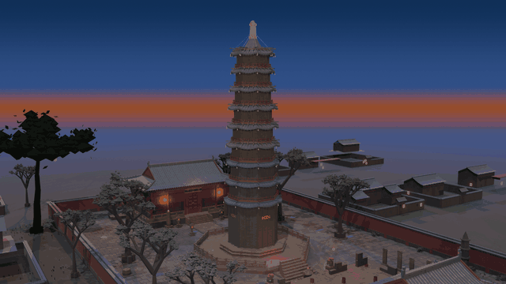
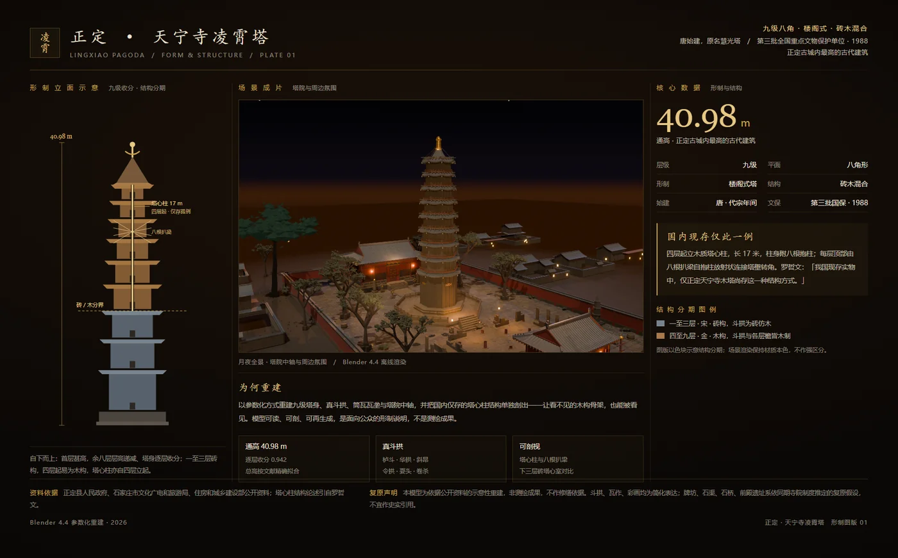
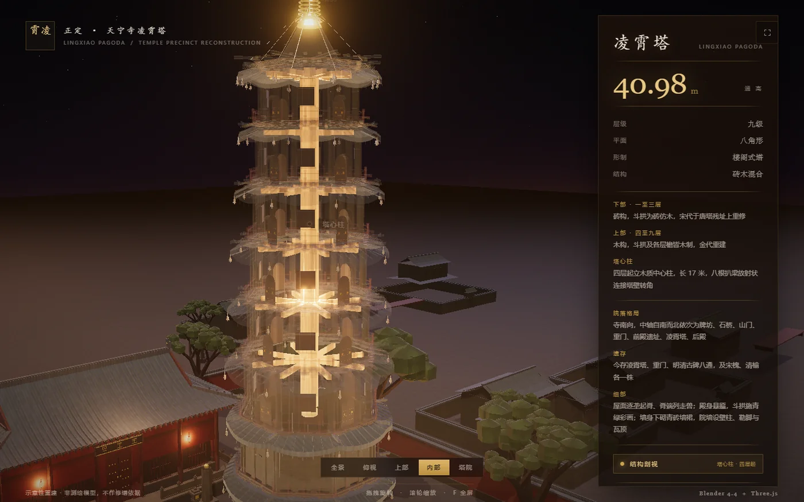
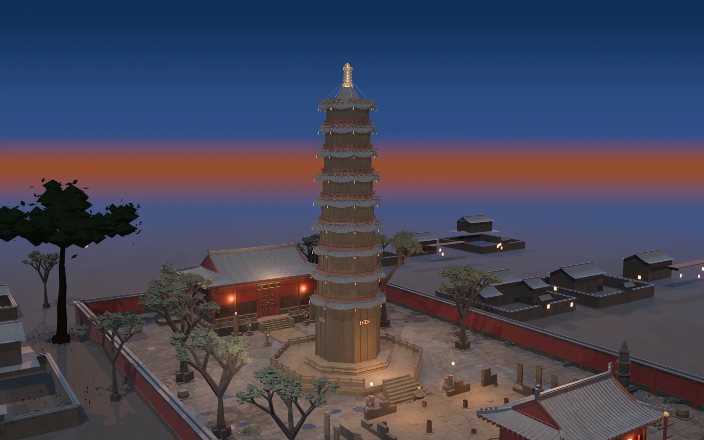
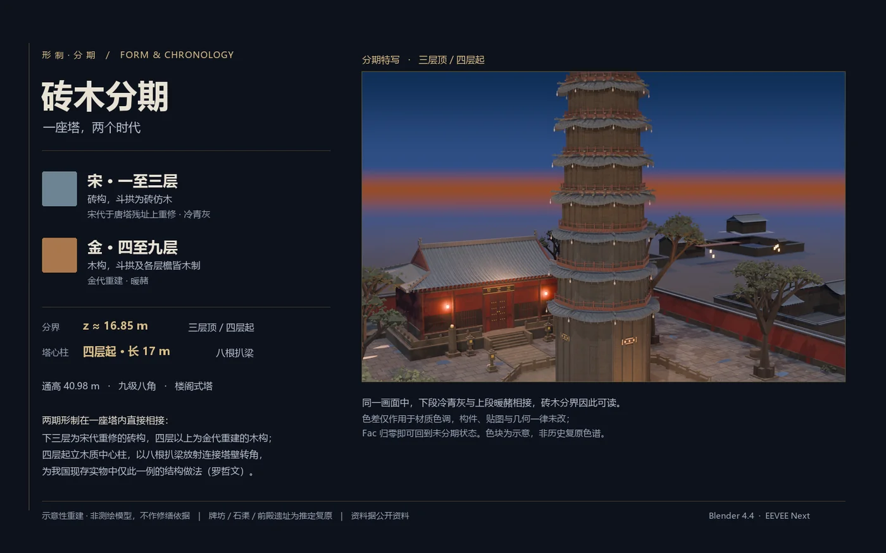
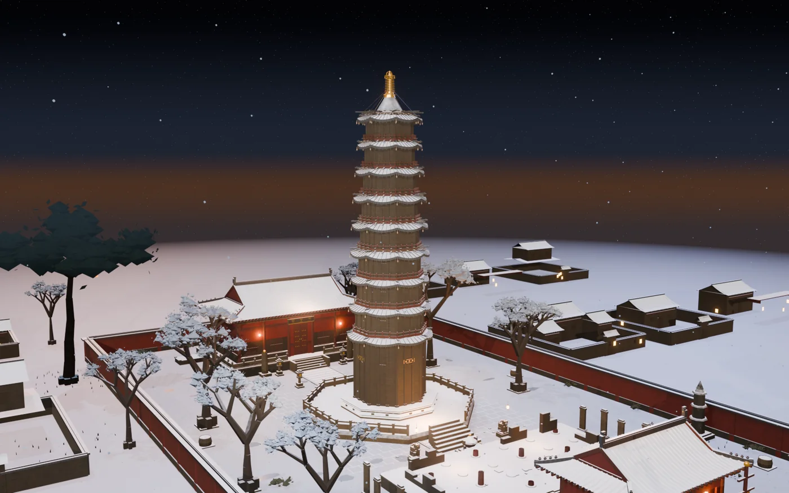
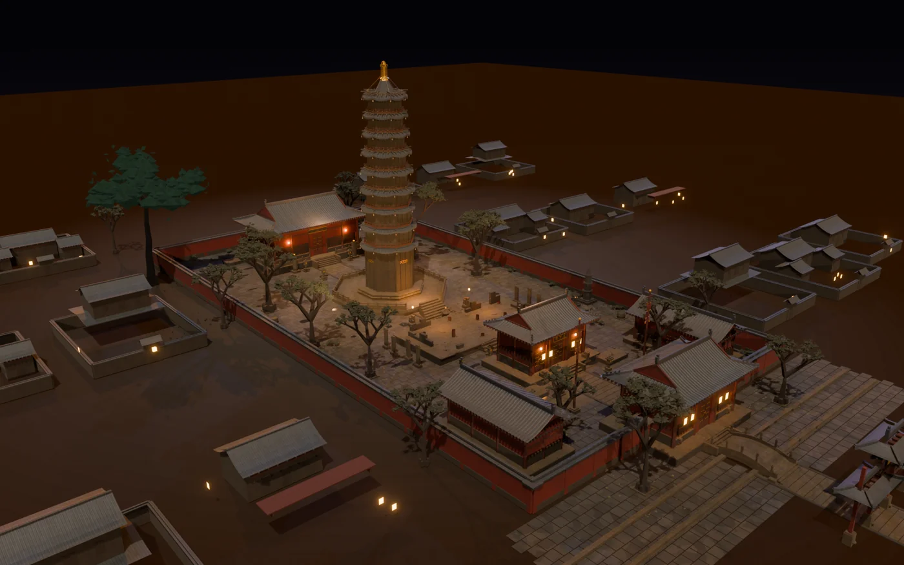
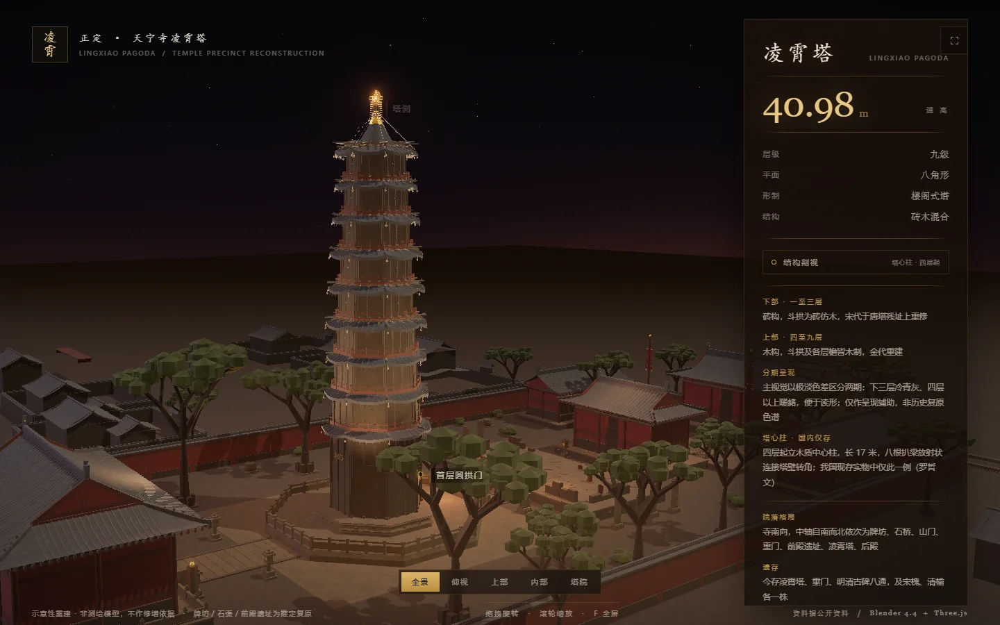

<div align="center">



# 正定天宁寺凌霄塔 · 参数化重建

**一座北宋古塔，从 Python 脚本里长出来**

<sub>Blender 4.4 · Python 7,706 行 / 25 个脚本 · Three.js · 全程零手工建模</sub>

### [▶ 在线体验 · 在浏览器里直接转塔](https://zhangyize044-cyber.github.io/Central-mast-Pagoda-Temples/)

<sub>可旋转 / 缩放、结构剖视（塔心柱 + 八根扒梁）、五机位切换、构件标注。无需安装，无需下载。</sub>

[](https://www.blender.org/)
[](https://threejs.org/)
[](./LICENSE)

</div>

---

> **这不是一个 `.blend` 文件，是一套生成系统。**
> 形制是参数，构件是函数，塔是跑出来的。改一个常量，塔的层数、层高、收分全部跟着变。

---

## 一、这个项目试图证明什么

不是"我会用 Blender"。是四件同时成立的事：

| 能力 | 在项目里的证据 |
| :--- | :--- |
| **读得懂古建筑** | 不是照着一张照片描外形，而是先把砖木分期、塔心柱受力、斗拱出跳的形制逻辑读明白，再决定几何怎么分层 |
| **能把知识转成参数** | 斗拱、瓦作、石作、木作写成可复用的构件库（`site_geo.py` 1,119 行），换一座形制相近的建筑能直接改写复用 |
| **有工程纪律** | 主体几何全程零改动；六条场景线（夜景 / 雪景 / 黄昏 / 分期 / 动画 / 开场）都是独立增量脚本，任何一层可整层删除回退 |
| **做得出影像** | 22 秒短片、1600×900 / 24 fps、原创程序化配乐，按 90 BPM 节拍表逐帧对位，不是渲染完随手配个 BGM |
| **说得出边界** | 哪一段是史实、哪一段是推定，明确写在页面和片尾。文保类项目里，这比渲染精度更重要 |

---

## 二、形制判断：先读懂，再建模

模型的数据来源是公开测绘与文献（正定县政府、石家庄市文旅局、住建部网站等），关键判断如下：

| 项 | 值 / 依据 |
| :--- | :--- |
| 通高 | **40.98 m**，正定古城内现存最高的古代建筑 |
| 形制 | **九级**，平面**八角形**，**楼阁式**塔 |
| 砖木分期 | 一至三层**砖构**，斗拱为砖仿木，宋代在唐塔残址上重修；四层以上斗拱及各层檐为**木构**，金代重建 |
| 塔心柱 | 四层起立木质**塔心柱**，长 **17 m**，八根**扒梁**放射状连接塔壁转角 |
| 台基 | **八角形**，首层甚高，四正面辟圆拱门，塔心室顶部穹窿顶 |
| 塔院 | 中轴自南而北：牌坊 → 石桥 → 山门 → 厢房 → 重门 → 前殿遗址 → 凌霄塔 → 后殿；院墙东西 **53 m**、南北 **104 m** |

罗哲文先生对塔心柱结构的评价：**"我国现存实物中，仅正定天宁寺木塔尚存这一种结构方式"**——这是整座塔在建筑史上最不可替代的一点，也是这个项目选择做剖视的主因。

### 把形制整理成一页图版

建模之前先把资料收敛成一页——立面示意、核心数据、结构分期、数据依据、复原声明各自归位。这一步不是为了好看，是为了**逼自己把不确定的地方标出来**。



<sub>左：立面收分示意，标出 40.98 m 通高、塔心柱 17 m、砖木分界。右：核心数据与「国内现存仅此一例」的结构说明。底部：数据来源与复原声明。</sub>



<sub>**结构剖视**。外壳逐层淡出，露出塔心柱与八根放射状扒梁。做成可交互的图层，而不是渲一张图——因为"能剖开看"才是这套几何真正的价值。</sub>

---

## 三、关键判断：几个不做常规选择的地方

下面是这个项目里我认为最值得说的判断，每一条都推翻了第一版做法。

### 1. 黄昏，不是月夜
第一版是月夜母版，通体幽蓝、气氛到位。但它把斗拱出跳、斜昂、瓦作垄口、砖木分界线**全压进了暗部**——观众记住氛围，记不住形制。

改成蓝调黄昏。天空从天顶靛蓝拉成地平线暖赭，环境光由暖棕转冷蓝灰，另补一盏高位中性柔光**只照构件、不抬地面**。代价是少了一点神秘感，换来塔身结构能被读懂。

> 对外展示要的是"看得见的形制"，不是"好看的气氛"。



### 2. 剖视用暗场，不用亮场
直觉做法是把外壳调透明。实际渲染出来是一副**发白的骨架**，像医学插图，完全没有建筑的体量感。

最后改成：外壳隐藏时同步压暗环境、只留九盏分层结构光扫过塔心柱和扒梁。暗场里轮廓才立得住。

### 3. 砖木分期只能用极克制的色差
宋砖与金木在真实建筑上的差异是**材料的**，不是颜色的。给太强的染色会变成示意图，给太弱看不见。

做了三轮极端染色诊断才定下来：色相只在冷暖轴上偏移，强度开关留在 `PERIOD_TINT` 的 Fac（最终 0.85）。这是"信息可读"和"不失真"之间的那条窄缝。



<sub>**砖木分期**。下三层宋砖构偏暖灰，四层以上金木构偏冷褐，塔心柱与扒梁单独提亮。</sub>

### 4. 动画不靠"运镜炫技"，靠节拍
22 秒里只有两个硬重音：**3.5 s**（第一盏灯亮）和 **11.5 s**（剖开露出塔心柱）。全片按 90 BPM 排拍，把音乐网格起点放在 `t = 1/6 s`，这两个时间点正好落在第 5、17 拍的小节线上——从 0 起拍会偏四分之一拍。

九级点灯每 0.4 s 一级，八根扒梁每 0.35 s 一根，都有对应的音。配乐是程序化合成的（钟磬、鼓、木构点击、弦垫），无外部音源、无版权风险。

<div align="center">


</div>

<sub>**左**：雪景。地面雪色压到 0.72、补高位形制光，避免死白把塔压成剪影。**右**：塔院。中轴、厢房、重门、院墙按 53×104 m 复原。</sub>

---

## 四、技术账

| 项 | 值 |
| :--- | :--- |
| 脚本 | **25 个 · 7,706 行**（Python，Blender `bpy` / `bmesh`） |
| 塔体 / 场地 | **128,286 三角面** / 约 77,000 面 |
| GLB | 9.2 MB + 13.3 MB（贴图内嵌） |
| 贴图 | 塔体 512² × 4 + 256² × 1；场地 512² × 8，全部程序化生成 |
| 短片 | 1600×900 / 24 fps / **528 帧** / 22.000 s / H.264 + AAC |
| 配乐 | 48 kHz / 16-bit / 立体声 / 22.000 s，程序化合成 |
| 依赖 | Blender 4.4 · three 0.186 · vite 8 · Playwright |

渲染全程走 **EEVEE Next + AgX**，无头模式批量出帧。中途踩过的坑（顶点色转纯 Emission 在 EEVEE 出白格与光柱、Glare 节点 4.4 socket 变更、`scene.camera` 无法关键帧需用 timeline marker 切机位）都记在 [`docs/design-notes.md`](./docs/design-notes.md)。

---

## 五、界面层



不是把 GLB 丢进 Three.js 就完事。这一层做了：九盏分层灯的阶梯点亮、结构剖视、五个预设机位、构件标注、竖屏自动后撤 1.34 倍（否则 41 m 的塔会顶满屏、塔刹被裁）。

桌面与移动两套尺寸都用 Playwright 做过检核：元素数量、边界不重叠、无横向滚动、零 JS 报错。

**已部署**：<https://zhangyize044-cyber.github.io/Central-mast-Pagoda-Temples/> —— 由 `web/` 构建后内联为单文件，托管在 `gh-pages` 分支（主分支保持轻量）。页面不依赖任何外部请求，断网也能渲染。

---

## 六、仓库结构

```
lingxiao-tower/
├── blender/                    建模与渲染层（25 个脚本，需同层扁平放置）
│   ├── build_tower.py          ★ 塔体参数化建模（1,043 行）
│   ├── site_geo.py             ★ 中式构件库：屋面/斗拱/石作/木作（1,119 行）
│   ├── build_site.py           ★ 塔院环境组装
│   ├── build_scene.py          合成单文件夜景场景
│   ├── site_detail.py          周边细节增量层（铺装/水石/灯火/大气）
│   ├── site_foliage.py         植被
│   ├── site_foreground.py      前景与剪影
│   ├── gen_textures.py         塔体贴图生成（numpy）
│   ├── gen_tex_site.py         场地贴图生成
│   ├── add_dusk.py             场景线①：蓝调黄昏
│   ├── add_snow.py             场景线②：雪景
│   ├── refine_snow_r2.py       场景线②精修
│   ├── add_period.py           场景线③：砖木分期着色
│   ├── build_animation.py      场景线④：22 s 节奏动画
│   ├── add_reveal.py           场景线⑤：结构 Reveal 开场
│   ├── compose_score.py        程序化配乐合成
│   ├── render_*.py             无头渲染（单帧 / 序列）
│   ├── overlay_endcard.py      短片落版叠字（末段压暗 + 标题淡入）
│   ├── encode_*.py             VSE 内建 H.264 编码
│   └── tex/                    程序化生成的贴图
├── web/                        Three.js 展示层
│   ├── index.html
│   └── src/{main.js, style.css}
├── docs/
│   ├── figures/                README 用图（压缩 webp，608 KB 全套）
│   └── design-notes.md         关键决策、踩坑与取舍记录
├── media/showcase-22s.mp4      22 秒展示短片（含原创配乐）
└── LICENSE                     代码 MIT / 图文 CC BY-NC 4.0
```

**关于 `.blend` 与 GLB**：原始工程文件（13 个 `.blend`，合计约 143 MB）和导出的 GLB 未纳入仓库，避免 clone 体积失控。需要完整工程或高精度模型，见下方联系方式。

---

## 七、运行

```bash
# 网页（需自备 GLB，放入 web/public/models/）
cd web && npm install && npm run dev     # http://127.0.0.1:5180

# 重建塔体（Blender 4.4）
blender -b --factory-startup --python blender/build_tower.py

# 重建塔院
blender -b blender/lingxiao_tower.blend --python blender/build_site.py

# 合成场景 → 黄昏 → 分期 → 动画
blender -b blender/lingxiao_tower.blend     --python blender/build_scene.py
blender -b blender/lingxiao_tower_scene.blend --python blender/add_dusk.py
blender -b blender/lingxiao_tower_scene_dusk.blend --python blender/add_period.py
blender -b blender/lingxiao_tower_scene_dusk_period.blend --python blender/build_animation.py
```

脚本之间用 `bpy.data.filepath` 和同目录 `import` 定位，**必须保持 `blender/` 扁平**，不要拆子包。

---

## 八、边界声明

**这是示意性重建，不是测绘模型，不能作为修缮依据。**

- 斗拱、瓦作、彩画均为简化表达，比例按公开数据与照片目测拟合
- **牌坊、石渠、石桥、前殿遗址为复原假设**——史料只载「重门—塔」这一段，前殿与山门前的处理是按同期寺院制度推定的，不宜当作史实引用
- 主体几何在全部呈现层迭代中未改动；所有氛围/动画改动都在独立集合内，可整层回退
- 已知遗留：仰视机位下翼角仍有夜景高光带，判断属于多光源 + ACES + 泛光的组合效应，非几何缺陷

---

## 九、参考与致谢

- [huangbai-AI/yingxian-pagoda](https://github.com/huangbai-AI/yingxian-pagoda) —— 应县木塔。本项目的**工作流**（Python 分步生成几何 → 无头导出 GLB → Three.js 网页）参考了其组织方式。该仓库无 LICENSE，本项目**未使用其任何代码或模型资产**。
- [cclank/cell-architecture-studio](https://github.com/cclank/cell-architecture-studio)（MIT）—— "3D 展品 + 侧边信息面板"的界面结构参考。**未使用其代码**，展示层为独立编写。
- 形制数据：正定县人民政府、石家庄市文化广电和旅游局、住房和城乡建设部公开资料

---

## 十、作者

<!-- 建议把下面的显示名改成本名，作品集用真名更有说服力 -->
**zhangyize044-cyber** · 建模 / 渲染 / 前端 / 影像

[](mailto:zhangyize044@gmail.com)
[](https://github.com/zhangyize044-cyber)

<sub>如果这个项目对你有帮助，或者你在做古建筑数字化相关的事，欢迎联系交流。</sub>

**延伸阅读**：[《我不建模，我写代码：7,706 行 Python 生成一座 40.98 米的古塔》](./docs/article.md) —— 讲讲那些推翻第一版的判断，以及三个烧掉时间的坑。

---

<div align="center">
<sub>主体几何零改动 · 六条场景线可整层回退 · 全部渲染脚本可复现</sub>
</div>
