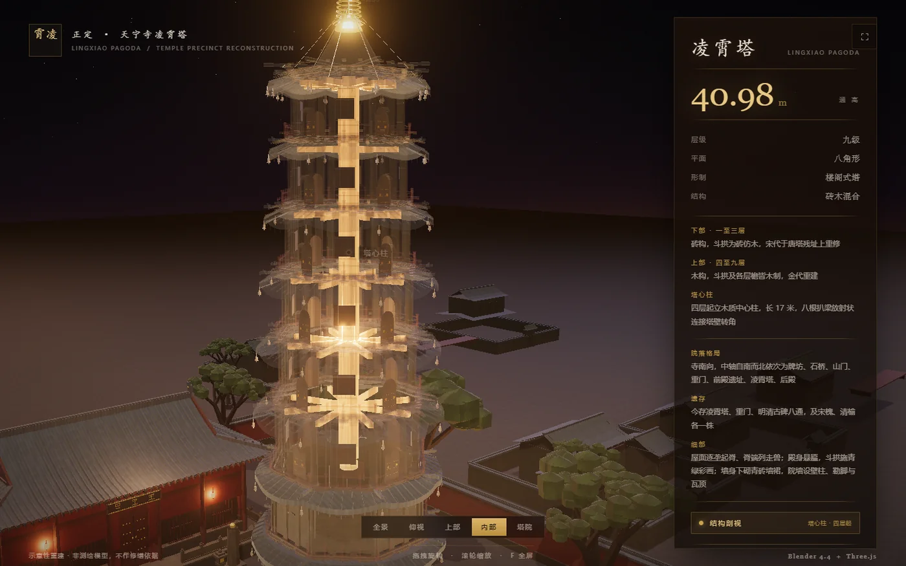
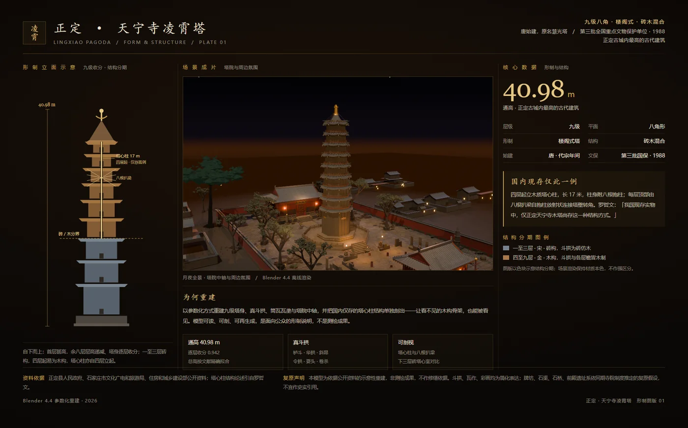
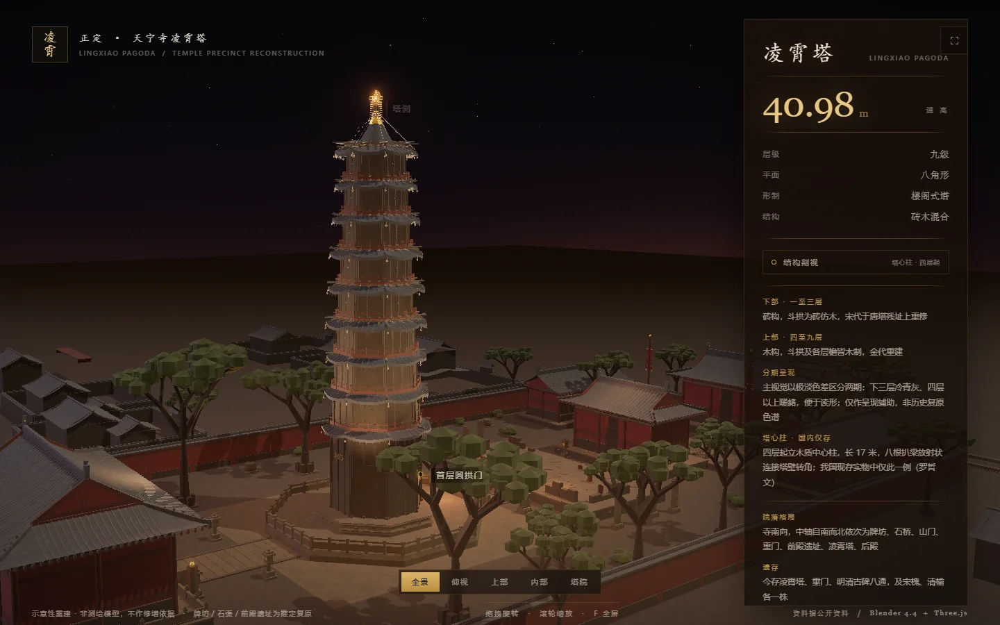
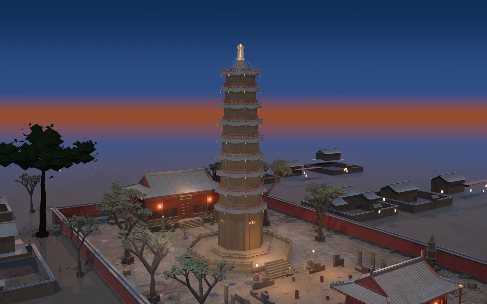
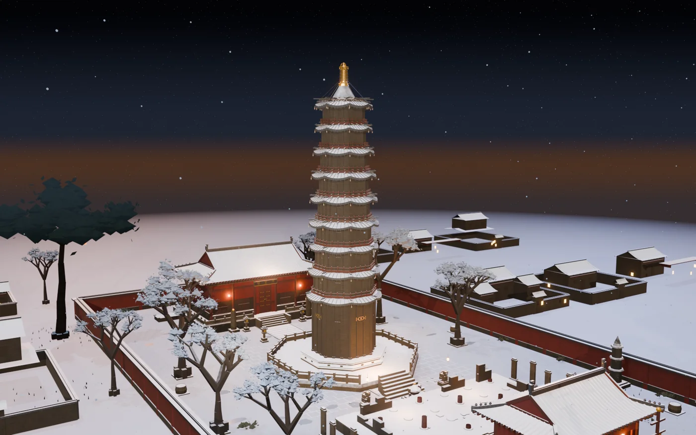
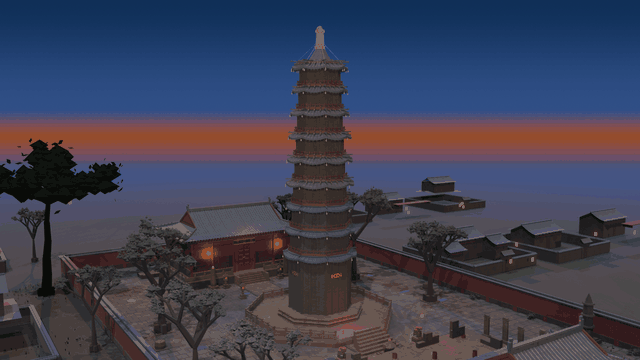
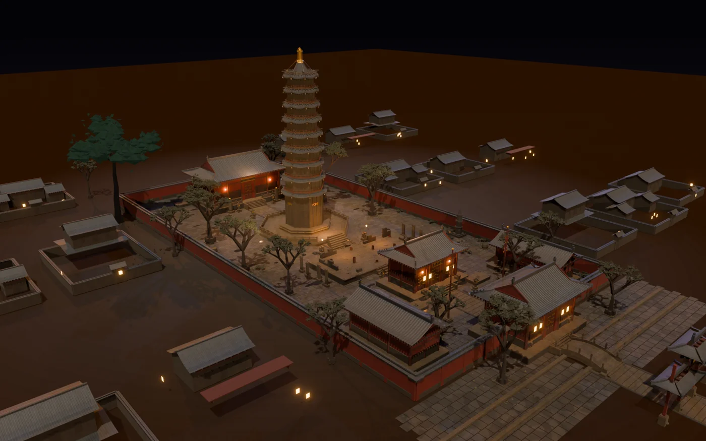

# 我不建模，我写代码：7,706 行 Python 生成一座 40.98 米的古塔

> 知乎版全文。图片需上传到对应平台后替换链接；本地预览时路径相对于 `docs/`。

正定天宁寺凌霄塔，40.98 米，九级八角。

站在塔下，你能看见的东西其实不多：砖、木、瓦、斗拱，被一千年磨成一片灰。

它最要命的部分在塔里面。

四层以上，一根 17 米长的木质塔心柱从塔身中心立起来，八根扒梁从柱身放射出去，钉进塔壁的八个转角。整套结构像一把撑开的伞——塔壁是伞面，塔心柱是伞骨交汇的那个点。

罗哲文先生说过一句话：**我国现存实物中，仅正定天宁寺木塔尚存这一种结构方式。**

我做了一件事：用 Python 把这座塔从零生成出来，然后把它剖开给你看。



---

## 一、为什么是这座塔

不是随手挑了个有名的。

凌霄塔的不可替代性只有一条：**塔心柱**。别的塔把荷载交给塔壁和楼层，它把重量吊在一根木柱上——柱在，塔立；柱朽，塔危。这套做法没有在后世延续下来，现存实物里只剩这一例。

更麻烦的是，它不是"一座塔"，是**两套建造逻辑拼在一起**：

- 一至三层是砖构，斗拱用砖仿木，宋代在唐塔残址上重修；
- 四层以上是木构，各层檐、斗拱、平座都是真木头，金代重建。

这不是配色差异。砖构的收分靠砌筑，木构的收分靠榫卯；砖仿木的斗拱是"雕出来的样子"，木斗拱是"能受力的一跳"。把这两段用同一种几何语言糊过去，塔看起来还是那个塔，但它已经不成立了。

所以这一节只有一个判断：**如果我只是把外形描出来，我做的是复制品；我要还原的是"为什么这么建"。**



建模之前我先把资料收敛成一页纸：立面收分示意、通高与塔心柱长度、砖木分界、每条数据的出处、以及一句"哪些是推定的"。

这一步不是为了好看。是为了**逼自己把不确定的地方标出来**——凡是标不出来的，后面建模时一定会含糊过去。

---

## 二、为什么参数化，而不是手工建模

这是全文第一个硬判断，也是最容易被同行问"值不值"的地方。

手工建模的原型是"这一个"。改层数？重做。改收分比例？重做。想做雪景版？复制一份文件，重做天气和材质。

参数化的原型是"这一类"。塔是算出来的——`build_tower.py` 开头就是一张参数表：

```python
P = {
    "base_h":      2.00,   # 台基
    "body_h":     34.00,   # 塔身
    "finial_h":    4.98,   # 塔刹      → 合计 40.98 m
    "r_first":     4.40,   # 首层半径
    "taper":       0.942,  # 逐层收分
    "body_taper":  0.978,  # 层身收分
    "brick_tiers": 3,      # 一至三层砖构，四层以上木构
}
```

改 `taper`，九级的收分曲线整体重算，每层半径、斗拱排布、檐口出挑跟着变；改 `brick_tiers`，砖木分界自动上下挪，两套材质的边界不用重画。

第一版写的不是塔，是一套构件库——`site_geo.py` 1,119 行，屋面、斗拱、石作、木作各成一族函数；`build_tower.py` 1,043 行，把这些构件按形制规则堆成一座塔。但**中期回本**来得很快：

v3 几何定稿之后，我在同一套生成代码上叠了六条场景线——夜景母版、雪景、蓝调黄昏、砖木分期、22 秒节奏动画、结构 Reveal 开场。每一条都是独立增量脚本，只加层、不改主体，任何一层可以整层删掉回退。

如果当初是手工建模，这就是六次重做。



代价也得说清楚，否则这个判断不成立：

**参数化写不出手工雕刻的随机性。** 手工建模里，你会顺手把某一块砖挪歪两毫米、把某一片瓦换一个灰度——那些"不必要的不精确"恰恰是真实感的来源。程序生成的默认结果是**精确而均匀**的，而精确而均匀的东西，比手工建模更假。

所以参数化必须配一套同样扎实的程序化材质和随机种子：瓦垄要有疏密、砖缝要有深浅、木纹要沿构件方向走。这部分的工作量，被大多数人低估了。

一句话总结这件事：

> 手工建模是在做一个作品，参数化建模是在写一个能生成作品的工具。前者交付结果，后者交付能力。

---

## 三、为什么是黄昏，不是月夜

第一版是月夜。

通体幽蓝，塔身从黑暗里浮出来，塔刹挑着一勾冷光。氛围是到位的，我自己也看着满意。

但看着看着发现一个问题：那一版里，斗拱出跳、斜昂、瓦作垄口、砖木分界线，**全被压进了暗部**。我能说出这座塔有多高、几层、什么平面，却说不出它的斗拱是几跳——而这些恰恰是我花最多力气去建模的部分。

**观众记住了氛围，记不住形制。**

这就是问题。月夜适合做海报，不适合做"展示"。展示的目的是让人读懂这座建筑，而夜景的本质是把信息藏起来。

改了蓝调黄昏。天空从天顶靛蓝拉成地平线暖赭，环境光由暖棕转冷蓝灰，另外补一盏高位中性柔光——**只照构件，不抬地面**。



这里有个细节值得单独说，因为它是最容易把画面做"平"的地方：

**一个暖光会把灰瓦、红墙、青砖全染成同一个橙棕。** 单色温照明下，所有材质的差别都会被抹掉，画面立刻变扁。所以必须加一盏冷调补光，让阴影走蓝灰而不是走暖黑——同一个物体上冷暖并存，材质才重新分出层次。

代价是少了一点神秘感。换来的是塔身可以被读懂。

> 对外展示要的是"看得见的形制"，不是"好看的气氛"。



顺带说一句雪景。它不是为了好看才做的——雪把地面亮度和塔身亮度压到接近，是对"形制光"最严苛的一次压力测试。雪色压不下去，塔就会被死白吃掉，变成一张剪影。

---

## 四、剖视为什么必须做暗场

这是我最初判断错得最厉害的一处。

直觉做法：把外壳的透明度调上去，让它慢慢淡出，露出里面的塔心柱。

实际渲出来是一副**发白的骨架**。像医学插图，不像建筑。

原因很具体：外壳一旦透明，那根 14,000 W 的冷白柔光就直接打在裸露的塔心柱上，把它照成一个纯白的发光体。形体还在，但体量感没了——因为**体量感来自明暗交替，不是来自轮廓**。

真正的修法不在"透明"，在"变暗"：

- 外壳淡出的同一时间，九级灯逐盏关掉；
- 立面光压到 22%，主光压到 8%，天空强度压到 0.34；
- 塔心柱的 Base Color 压成深棕，但**保留吃光能力**。

最后这一条是关键。一开始我图省事，把柱体做成了纯 Emission（自发光），想着暗场里它自己会亮。结果是八根扒梁看上去是一块平的白板——因为纯 Emission 不吃光，没有明暗，也就没有"依次亮起来"这件事。

改回漫反射材质，靠那九盏结构灯一盏一盏扫过去，扒梁才真正读得出顺序。

> 让人看见结构，不是把遮挡物变透明，是把周围变暗。

这句话后来成了整个项目的通用法则。所有"要让人看见什么"的时刻，第一步都不是加强那个东西，是**削弱它周围的光**。

---

## 五、三个把时间烧掉的坑

技术读者大概只关心这一段，我写细一点。每个坑按"现象 → 误判 → 诊断 → 修法"来。

### 坑 1：EEVEE Next 读不到顶点色

**现象**：地面石板亮成一片米白格子，落叶变成满地白点，本该半透明的青烟变成几根不透明的光柱。

**误判**：第一反应是材质参数写错了。调了两小时粗糙度、法线、混合模式，毫无变化。

**诊断**：停止猜。把每类对象的材质临时换成一个固定的暗 Emission（不依赖任何输入），再逐层隐藏细节对象，各渲一张低采样图对比——哪一层变成纯白，问题就在哪一层。

结论很快出来：所有用到顶点色（vertex color）的材质都退回了默认白色。

**根因**：EEVEE Next 读不到 CORNER 域的 `FLOAT_COLOR` 属性。两种常用节点写法都失效，且不报错。

**修法**：彻底放弃顶点色，全部改成纯程序化材质——用 Object Info 的随机值、几何位置、法线方向驱动变化。麻烦，但从此不再有"你以为在用数据，其实在用默认值"的隐患。

### 坑 2：调暗 40% 是看不出变化的

**现象**：夜景明显过曝，浅色构件糊成一片。凭感觉把 Base Color 调暗 40%，重新渲——**看不出任何区别**。

**误判**：以为改错了材质槽，反复确认节点连线。

**诊断**：把 Base Color 从 0.06 一路往下试，每档渲一张。0.06 仍然过曝，0.03 还是过曝，直到 **0.008–0.022** 才在夜景里呈现出正常的深灰。

**根因**：场景里有 32 盏灯，曝光 1.25。浅色漫反射在这个光照量级下早就饱和了，颜色值在饱和区里改动，输出端根本没有响应。

**教训**：在过曝区调参，等于在噪声里调参。**得按数量级调，不是按百分比调。**

> 调参数之前先做一次数值诊断。肉眼在暗场里几乎不可靠。

### 坑 3：本机 ffmpeg 是 0 字节空壳

**现象**：成片编码那一步失败。检查发现 `ffmpeg.exe` 文件存在、能执行、返回成功——但什么都不输出，文件大小 0 字节。

**误判**：以为命令参数写错了，换了几套参数组合。

**诊断**：单独执行 `ffmpeg -version`，无输出。查文件大小：**0 字节**。是个占位空壳。

**修法**：不再依赖外部工具，改用 Blender 内置 libavcodec 的 VSE 序列编辑器编码——Blender 本来就在链路上，少一个外部依赖反而更稳。

顺带一个习惯：**成片不能用"文件大小正常"来判断成功**。我最后是把它重新读回 Blender，解码确认 528 帧、22.000 s、音轨长度一致，才算交付。

---

## 六、22 秒里的两个重音

短片只有 22 秒。22 秒里做节奏，能用的东西其实只有一样：**重音**。

全片只安排两个硬重音：

- **3.5 s**：第一盏灯亮，画面从纯黑硬切进来；
- **11.5 s**：外壳剖开，露出塔心柱。

其余全是过程。中间那段"敢留多长的静"，决定了这两个重音有多重。

配乐是我自己合成的——本机没有任何音源素材，系统 Python 连 numpy 都没有。但 Blender 自带 numpy，够用了：钟磬用非谐波泛音堆，鼓用 pitch sweep 加低通噪声，木构点击用短噪声加一个共振峰，最后过一层合成混响。

关键不在音色，在**对位**。全片按 90 BPM 排拍，但音乐网格的起点不能放在 0——放在 `t = 1/6 s`，3.5 s 和 11.5 s 才会正好落在第 5 拍和第 17 拍的小节线上。**从 0 起拍，这两个点会偏四分之一拍**，听感上就是"总差一点，说不上哪里不对"。

数值上也复核过：两个重音前后的 RMS，一个从 0.0157 跳到 0.2866，一个从 0.0088 跳到 0.3613。硬跳成立，不是"感觉变响了"。



九级点灯每 0.4 s 一级，八根扒梁每 0.35 s 一根，都有对应的音。这些数字不是美学，是让画面和声音同时到达同一个点。

> 节奏不是剪得快，是两个重音之间敢留多长的静。

---

## 七、哪些是推定的

这一节我放在最后，但它决定前面所有内容可不可信。

史料对天宁寺塔院的记载，只到「重门—塔」这一段是清楚的。

**牌坊、石渠、石桥、前殿遗址，是按同期寺院制度推定的。** 我没有把它们当作史实，也不希望别人引用时当作史实。



模型是**示意性重建，不是测绘模型**，不能作为修缮依据。斗拱、瓦作、彩画都是简化表达，比例按公开数据与照片目测拟合。

还有一条已知缺陷，我也写在这里：仰视机位下，翼角仍有一条夜景高光带。我判断是多光源 + ACES + 泛光的组合效应，不是几何问题，但我没有最终修掉它。

> 在文保类项目里，含混比缺失更糟糕。

写清楚这些，懂行的人才会信任你前面做的一切。反过来，一处含糊被抓住，整篇文章就都不作数了。

---

## 最后

这不是一个模型文件，是一套生成系统。

形制是参数，构件是函数，塔是跑出来的。

- 仓库（代码 MIT / 图文 CC BY-NC 4.0）：https://github.com/zhangyize044-cyber/Central-mast-Pagoda-Temples
- 在线体验（浏览器里直接转塔、剖视、切机位）：https://zhangyize044-cyber.github.io/Central-mast-Pagoda-Temples/

如果你在做古建筑数字化，或者在用代码做任何"本该手工做"的东西，欢迎来聊。

---

<sub>主体几何全程零改动 · 六条场景线可整层回退 · 全部渲染脚本可复现</sub>
